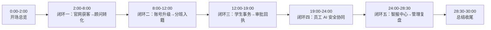

# 粤教教育服务平台 · 30 分钟项目演示录屏操作清单

> **录屏目标**：只演示**项目运行效果 + 业务流程 + 多角色闭环**，不讲开发过程与技术细节。  
> **建议时长**：28～30 分钟（按 5 大真实业务闭环推进，串联 6 类角色）。

---

## 一、录屏前准备清单（开录前 10 分钟逐项勾选）

- [ ] **启动本地服务**：
  - 后端 API：`http://127.0.0.1:8002`（确认 `/health` 返回 `{"status":"ok"}`）
  - 前端服务：`http://127.0.0.1:5173`（官网入口 `/website`，企业工作台 `/`）
  - 本机 Dify 服务处于运行且已发布状态
- [ ] **检查 6 角色快捷一键登录**（仅限本机 `127.0.0.1` 开发环境，密码不出现在录屏与讲稿中）：
  - 企业工作台登录页：`管理员`、`顾问（周景明）`、`主管（林若溪）`、`班主任（陈思齐）`
  - 官网登录弹窗：`游客`、`学生`
- [ ] **双窗口布局（强烈推荐）**：
  - **窗口 A**：打开 `http://127.0.0.1:5173/website`（用于演示官网、游客端、学生端）
  - **窗口 B**：打开 `http://127.0.0.1:5173/`（用于演示顾问、班主任、主管、管理员工作台）
  - 提前关闭无关标签页、微信/系统弹窗通知；分辨率 `1920×1080`，浏览器缩放 `100%` 或 `110%`
- [ ] **准备演示素材**：
  - 桌面或项目根目录准备 1 份用于上传演示的客户资料文件（例如 `张三-客户资料.txt` 或 PDF 简历）
- [ ] **AI 预热（避免录屏首次冷启动等待过久）**：
  - 在顾问端「AI 助手」新建一个“预热测试”会话，发一句 `查询我的待办` 确认响应正常后再正式开录（Dify 正常耗时约 4～15 秒，中位 7 秒，录屏时等待期间直接口播讲解流程，**切勿重复点击**）

---

## 二、30 分钟全流程总览



| 时间段 | 模块 | 涉及角色 | 核心闭环验证 |
| :--- | :--- | :--- | :--- |
| `0:00–2:00` | 开场总览 | 官网 + 工作台 | 双入口与 6 角色业务全景 |
| `2:00–8:00` | 闭环一：获客与线索转化 | 游客 → 顾问 | 官网预约/交材料 → 顾问认领/通话/初筛/客户画像 |
| `8:00–12:00` | 闭环二：游客升级学生入班 | 管理员 | 官网账号开通学生身份 → 选项目与班级 → 身份自动切换 |
| `12:00–19:00` | 闭环三：学生服务与跨端审批 | 学生 → 班主任/主管 → 学生 | 学生 AI 发起请假/反馈 + 心理自评 → 员工端审批处理 → 学生收到回执 |
| `19:00–24:00` | 闭环四：员工 AI 协同办公 | 顾问 → 主管 | 按权限直查客户 → 口述写操作（先核对→取消/确认→业务页验真） |
| `24:00–28:30` | 闭环五：智报中心与复盘 | 主管 / 管理员 | 经营/投诉/日报/心理看板 + 图表下钻 + 正式报告生成与 PDF 下载 |
| `28:30–30:00` | 总结收尾 | — | 业务闭环、权限隔离、AI 安全可控三点收束 |

---

## 三、分阶段操作清单与口播要点

### 阶段 0：开场总览（`0:00 – 2:00`）

1. **画面操作**：
   - 先展示 **窗口 A（`/website` 官网首页）**，向下慢速滚动展示留学项目与服务栏目。
   - 切到 **窗口 B（`/` 企业工作台登录页）**，示意角色快捷登录入口。
2. **口播要点**：
   > “大家好，今天用大约 30 分钟演示我们组的「粤教教育服务智能平台」运行效果。整个系统围绕教育留学机构的真实业务，分为对外**官网与学生服务中心**、对内**企业智能工作台**两大入口，打通了游客、学生、顾问、班主任、主管、管理员 6 类角色。接下来我会沿着一个用户从官网咨询、顾问跟进、升级入学到在校服务、管理复盘的完整生命周期，逐一展示 5 个端到端闭环。”

---

### 阶段 1：闭环一 · 官网获客 → 资源池认领 → 客户画像与初筛（`2:00 – 8:00`）

1. **游客端操作（窗口 A）**：
   - 点击右上角「登录」→ 点击 **`游客一键登录`**，进入游客服务页。
   - 演示 **公开智能客服**：打开官网客服问答（如咨询新加坡升学或德国职业培训），展示实时回复。
   - 切到「活动预约」Tab → 点击预约一场活动 → 切到「我的预约」确认状态为 **已预约**。
   - 切到「材料提交」Tab → 上传准备好的测试资料文件（或填写文字资料）并提交。
   - 顺手展示「个人信息」与「我的客户档案」入口（如已关联）。
2. **顾问端操作（窗口 B）**：
   - 点击 **`顾问一键登录`**（周景明），进入工作台。
   - 点击左侧「**资源池**」：
     - 在「待认领」中展示未认领前不暴露游客联系方式；点击「跟进该游客」→「确认跟进」。
     - 切到「我已认领」→ 打开该游客的跟进抽屉（或直接进入「**客户管理**」对应客户详情页）：
       1. 展示 **预约与签到** 区域（能实时看到刚才游客在官网预约的活动，支持核销/签到）；
       2. 记录一条 **通话/跟进记录**（例如：`已电话回访，确认意向为新加坡项目，预计明年入学`）；
       3. 展示 **游客提交的材料**（可查看原件/正文，点击「识别并导入」同步到客户画像）；
       4. 运行 **初筛研判**，展示系统输出的匹配结论与缺失项提示；
       5. 演示客户状态流转（如从新线索推进到联系中/已确认意向）。
3. **闭环强调口播**：
   > “可以看到，游客在官网做的活动预约和提交的报名材料，顾问在后台无需人工微信传文件，认领后就能实时看到、导入画像并完成初筛和跟进流转，完成了获客到 CRM 建档的第一层闭环。”

---

### 阶段 2：闭环二 · 游客升级学生入班与权限体系（`8:00 – 12:00`）

1. **管理员端操作（窗口 B）**：
   - 退出顾问账号 → 点击 **`管理员一键登录`**。
   - 进入「系统管理 → **官网账号**」：
     - 找到游客账号，点击「开通学生身份」→ 选择「新建学生档案」→ 依次选择 **项目** 与 **班级** → 确定开通（展示该账号状态变为 `学生已开通`，并显示学生档案编号）。
   - 快速切过以下两个管理页（各停留 15～20 秒，不做冗长录入）：
     - 「教务管理 → **班级管理**」：展示项目、班级、班主任与在读学生的绑定关系；
     - 「系统管理 → **角色权限**」：展示菜单权限与功能权限的精细勾选，说明不同角色登录后导航和数据范围完全由服务端实时控制。
2. **闭环强调口播**：
   > “官网账号一旦开通学生身份并分班，不需要换网址或重新注册，用户再次从同一个官网入口登录，系统会自动识别身份并进入学生服务中心，同时把这名学生纳入对应班主任的授权范围。”

---

### 阶段 3：闭环三 · 学生全周期服务 + 学生 AI 助手 + 跨端审批闭环（`12:00 – 19:00`，重点）

1. **学生端操作（窗口 A）**：
   - 退出游客账号 → 点击「登录」→ 点击 **`学生一键登录`**，进入 **学生服务中心**。
   - **欢迎首页**：快速展示留学方向、近期考务提醒、院校申请进度、近期通知，以及左侧「申请进度」「留学政策」「海外生活」「我的材料与活动」模块。
   - **学生 AI 助手（核心演示）**：
     - 点击左侧「**学生助手**」，展示顶部工具栏（对话记录 / 当前情况 / 我的记忆 / 新对话）。
     - 输入固定话术发起真实业务（二选一或连演）：
       ```text
       我下周一上午因为身体不舒服需要请病假一天，请帮我准备请假申请
       ```
     - 展示 AI 多轮整理出结构化**请假草稿卡片**（可展示附件上传/核对字段）→ 点击 **确认提交**，生成真实请假单。
     - 顺手点开「当前情况」抽屉，展示学生学籍、所属班级、班主任与申请进度总览。
   - **自评与关怀**：进入「自评与关怀」，提交一次心理状态打卡/自评。
2. **班主任端操作（窗口 B）**：
   - 退出管理员 → 点击 **`班主任一键登录`**（陈思齐）。
   - 进入「**请假审批**」：看到学生刚刚提交的请假单 → 点击审批（填写审批意见并同意）。
   - 进入「**学生关怀 / 预警**」：展示班级授权范围内的学生心理预警与情绪记录（强调班主任只能看到自己所带班级学生）。
   - 快速展示「**成绩管理**」与「**我的学生**」（体现班主任日常教务管理）。
3. **主管端操作（窗口 B，可选 1 分钟）**：
   - 若学生端同时提交了投诉/反馈，可切 **`主管一键登录`**（林若溪）在「**投诉工单**」中查看并处理该工单，展示分配与状态更新。
4. **回切学生端验证闭环（窗口 A）**：
   - 刷新或在左侧点击「**请假申请**」与「**站内通知**」：
     - 展示刚才的请假单状态已实时变为 **已通过**，且收到审批回执与站内通知。
5. **闭环强调口播**：
   > “这一段是学生端最核心的闭环：学生用自然语言跟 AI 说请假，AI 整理成标准草稿并由学生确认提交；班主任在后台实时审批，结果立刻回流到学生端的请假记录和站内通知，全程有留痕、无断层。”

---

### 阶段 4：闭环四 · 企业 AI 助手赋能员工日常（`19:00 – 24:00`）

1. **顾问端操作（窗口 B）**：
   - 切回 **`顾问一键登录`**（周景明），点击左侧「**AI 助手**」，点击「新建对话」。
   - **演示 1：真实业务查询与权限隔离**（依次发送，等待回复期间口播解释）：
     ```text
     查询我的待办
     ```
     ```text
     查询我的客户列表
     ```
     ```text
     查询一下林晓宁
     ```
     *(注：按实际名下存在的客户姓名替换，展示按姓名直查本人名下客户详情；若查非本人客户则会被权限隔离拦住)*
   - **演示 2：写操作先核对 → 取消 → 再确认 → 业务页验真**（核心安全亮点）：
     ```text
     新增待办，标题为录屏演示回访整理，说明为整理本周重点客户问题并安排回访，优先级高
     ```
     - 等待确认卡片出现 → 指出标题、说明、中文优先级（高）均已结构化 → 先点 **「取消操作」**（说明此时**不会写入数据库**）。
     - 再次发送同一句 → 核对后点击 **「确认执行」** → 等待返回成功与待办编号。
     - 点击左侧「**我的待办**」刷新页面，指出刚刚通过 AI 创建的 `录屏演示回访整理` 已经真实落库。
2. **主管端操作（窗口 B）**：
   - 切 **`主管一键登录`**（林若溪），进入「**AI 助手**」，新建对话，输入：
     ```text
     统计本周日报提交情况
     ```
   - 展示主管可以查询授权部门的日报汇总，而普通顾问没有该权限；刷新页面重新点开历史会话，展示记录完整保留。
3. **闭环强调口播**：
   > “我们的企业 AI 助手不是简单套壳聊天，而是深度绑定了权限和确认状态机：查数据时严格按当前员工权限隔离，写数据时必须先生成中文核对卡片，员工点取消绝不入库，点确认才真实写入业务表，并且有防重复提交保护。”

---

### 阶段 5：闭环五 · 智报中心与管理复盘（`24:00 – 28:30`）

1. **主管/管理员端操作（窗口 B）**：
   - 使用 **`主管一键登录`**（林若溪）或 **`管理员一键登录`**，点击左侧「**智报中心**」。
   - **客户经营看板**：
     - 展示核心 KPI（周期新增线索、签约、流失、环比对比）与多维分布图表（状态分布、流失原因、意向国家、学历分布环形图、意向项目、来源渠道、部门经营对比、客户跟进方式）。
     - **亮点动作 1（图表下钻）**：点击任意图表柱条/图例（如 `意向国家 · 德国`），弹出明细抽屉，直接看到底层真实客户记录。
     - **亮点动作 2（报告归档与 PDF 下载）**：点击「**生成报告**」→ 等待归档完成 → 点击「**下载 PDF**」，打开下载好的 PDF 展示正式报表排版。
   - **切换其他看板快速展示**：
     - 「**投诉周报**」：展示投诉状态环形图、积压账龄柱状图、满意度分布；
     - 「**员工日报周报**」：展示提交统计与跨项目服务健康度；
     - 「**心理健康周报**」：展示班级心理预警分布与隐私门槛保护说明；
     - 「**计划与归档**」：展示定时报表任务与历史归档列表。
2. **闭环强调口播**：
   > “前面所有一线动作——游客咨询、顾问跟进、学生反馈、员工日报和班主任关怀——最终都会汇总到智报中心，既能点击图表下钻查明细，也能一键生成正式 PDF 归档，形成‘一线执行 → 数据沉淀 → 管理决策’的最终闭环。”

---

### 阶段 6：总结收尾（`28:30 – 30:00`）

- 停留在「智报中心」或「工作台首页」，用 3 句话收尾：
  > “以上就是我们项目的完整运行演示。总结来说有三个核心特点：第一，**全链路业务闭环**，从官网游客获客到入班入学、在校服务再到管理复盘全流程数据贯通；第二，**严格的权限与数据隔离**，6 类角色所见即所得，均由服务端实时鉴权；第三，**AI 真正融入业务且安全可控**，既有面向游客和学生的智能服务，也有面向员工带核对确认机制的业务助手。感谢老师和同学观看！”

---

## 四、录屏避坑与应急备忘

1. **不要连续点击发送**：Dify 理解与生成耗时约 4～15 秒，发出指令后边等边讲业务价值，避免重复触发。
2. **写操作如果偶发超时**：先切到对应业务页面刷新核对是否已保存，不要盲目重发同一条写指令。
3. **表述准确性注意**：
   - 不要用“你好 / 你能帮我做什么”证明 Dify 连通（那是服务端快捷回复），用真实业务查询演示；
   - 企业助手的会话历史是会话记录，不要误说成跨会话的 Mem0 长期用户画像记忆；
   - 未点击「确认执行」的草稿不要说成“已经提交成功”。
4. **切角色尽量用快捷按钮**：避免在镜头前反复手敲手机号和密码拖慢节奏。
