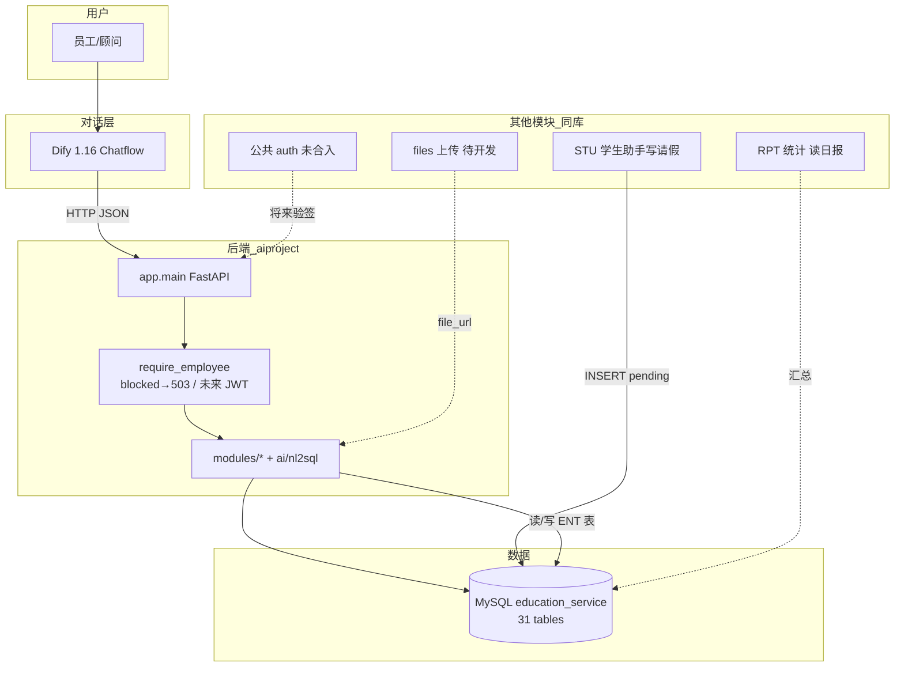

# 教育服务 AI · 全项目需求与模块关系说明

**范围**：以仓库 `aiproject/` 为交付主体（ENT 企业智能助手 + 公共后端骨架）；对照团队 `db_init.sql`（**31 张表**）、Dify 对话层、五模块分工。  
**读者**：产品、新人开发、联调负责人。  
**日期**：2026-11-11  

**相关文档**：  
- 口语汇报：`企业智能助手-组会汇报-进度与需求大白话.md`  
- 接口清单：`ENT-迁移与接口清单.md`  
- Dify 闭环：`客户管理-Dify闭环说明.md`  
- 认证：`回复Cursor/04-认证阻塞项与契约待决.md`  

---

## 1. 系统总览

### 1.1 业务目标

建设 **企业侧智能助手**：员工通过 **Dify Chatflow** 用自然语言完成 CRM、日报、审批、只读查数等；**LLM 不直连数据库**，只调用 FastAPI 白名单接口。

### 1.2 技术架构



### 1.3 运行时入口

| 入口 | 用途 | 身份 |
| --- | --- | --- |
| `app.main:app` | 生产/本地联调 Dify | `require_employee()`，默认 **503** |
| `tests.repro.asgi_app` | 权限 P2 演习 HTTP | 旧式 Bearer + 头，**仅限测试** |
| `/health`、`/health/db` | 探活 | **无鉴权** |

### 1.4 统一响应

```json
{ "code": 0, "message": "...", "data": { ... } }
```

业务失败：`code ≠ 0` 或 HTTP 4xx/5xx（consultant 已用真实 HTTP 状态码）。

---

## 2. 小组模块划分与职责

| 模块代号 | 业务 | 代码目录（目标） | 后端负责人 | Dify | 与 ENT 关系 |
| --- | --- | --- | --- | --- | --- |
| **ENT** | 企业助手 CRM/日报/审批/NL2SQL | `aiproject/app/modules/*`, `app/ai/nl2sql` | 刘培阳 | 企业 Chatflow | **本文主体** |
| **STU** | 学生请假/投诉/学籍 | `modules/student`（规划） | 后端 B / 木合塔尔 | 学生 Chatflow | **写** `student_admin_service`；ENT **读/审** |
| **CS** | 客服 offer/RAG | `modules/offer` 等 | Dify 同学 | 主 Chatflow | 共用客户/用户表，少 HTTP 互调 |
| **PF** | 客户研判 | `modules/` 扩展 | 后端 B | 工作流 | 共用 `crm_lead` 等 |
| **RPT** | 报表/日报汇总 | `modules/statistics` | 数据同学 | 可选 | **读** `employee_daily_report` |
| **公共** | 登录/JWT、附件 | `modules/auth`, `modules/files` | 集成负责人 | — | **阻塞** ENT 503 解除 |
| **运维** | 腾讯云 Docker | `aiproject/Dockerfile`, compose | 组长 | — | API `education-api:8000` |

**合并原则**：单 FastAPI 服务、`router_registry.py` 注册路由；**禁止**每人起一个独立 API 进程。

---

## 3. 数据库与模块数据域

### 3.1 ENT 已直接读写的表

| 表名 | 用途 | 写入方 | 读取方 |
| --- | --- | --- | --- |
| `crm_lead` | 意向客户主档 | ENT consultant | ENT、NL2SQL、enterprise_ops |
| `crm_follow_up` | 跟进记录 | ENT consultant | ENT、NL2SQL |
| `employee_daily_report` | 员工日报 | ENT employee_report | ENT、NL2SQL、RPT |
| `student_admin_service` | 请假等待办 | **STU 创建 pending** | ENT student_admin、NL2SQL、enterprise_ops |
| `sys_user` | 用户姓名/类型 | 团队初始化/他模块 | student_admin 按名找人（审批） |

### 3.2 规划使用、ENT 尚未实现的表

| 表名 | 规划能力 | 依赖 |
| --- | --- | --- |
| `sys_organization` | ENT-06 组织架构 | 查询 API 未写 |
| `onboarding_guide` | ENT-07 新人指引 | RAG/检索未写 |
| `student_score` | ENT-08 成绩 | 未排本期 |
| `student_feedback_ticket` | ENT-10 投诉 | STU-03/04 |
| `todo_item` | ENT-13 主动待办 | 定时任务未写 |
| `customer_profile` / `customer_source` | 客户扩展 | CS/PF 可能共用 |

### 3.3 库约定

- 库名：`education_service`；结构以 `db_init.sql` 为准。  
- 云上 **禁止** 擅自 DROP；结构变更走迁移 + 组内同步。  
- 附件：只存 **相对路径/URL**，上传由 **files 模块**（待开发）提供。

---

## 4. ENT 需求清单（功能 + 数据 + 实现）

状态图例：**已实现**｜**已测**｜**部署**｜**验收** — 见组会文档；`app.main` 业务当前 **503**。

### 4.1 ENT-01 意向客户录入

| 维度 | 说明 |
| --- | --- |
| **用户故事** | 顾问描述客户，系统结构化入库。 |
| **Dify** | LLM 提取 JSON → HTTP POST。 |
| **API** | `POST /api/v1/consultant/leads` |
| **请求体** | `LeadCreate`：`customer_name`（必填）, `owner_employee_id`（必填）, `contact_info`, `intended_country`, `source_channel`, … |
| **写表** | `crm_lead` |
| **规则** | `owner_employee_id` 必须等于当前员工（JWT 落地后来自 token）；创建时状态默认 `new`。 |
| **实现** | `modules/consultant/router.py` → `service.create_lead` → `repository` |
| **阻塞** | `require_employee` blocked → **503** |

### 4.2 ENT-02 客户档案与跟进

| 维度 | 说明 |
| --- | --- |
| **API** | `GET /api/v1/consultant/leads`（分页 keyword/status/owner） |
| | `GET /api/v1/consultant/leads/{id}`（档案 + `follow_ups` 列表） |
| | `POST /api/v1/consultant/leads/{id}/follow-ups` |
| **读/写表** | `crm_lead`, `crm_follow_up` |
| **跟进体** | `FollowUpCreate`：`employee_id`, `follow_type`, `content`, `next_plan` |
| **权限** | 仅 **owner** 员工可列表/详情/跟进；禁止查询他人 `owner_employee_id`；跟进人须与当前员工一致。 |
| **实现** | `ConsultantService.list_leads` / `lead_detail` / `add_follow_up` |
| **Dify** | 重名时先 list 或 NL2SQL 消歧再带 `lead_id` |
| **测试** | P2 在 `tests.repro` 已签收（repro 层） |

### 4.3 ENT-03 客户状态流转

| 维度 | 说明 |
| --- | --- |
| **API** | `PATCH /api/v1/consultant/leads/{id}/status` |
| **体** | `LeadStatusUpdate`：`status` ∈ new/contacting/qualified/signed/lost；`lost` 需 `lost_reason` |
| **写表** | `crm_lead.status`, `lost_reason`, `last_contact_time` 等 |
| **规则** | 状态机校验（非法跳转 409）；仅 owner 可改。 |
| **替代路径** | `POST /api/v1/enterprise/commands` action=`update_lead_status_by_name` |

### 4.4 ENT-04 / ENT-05 员工日报

| 维度 | 说明 |
| --- | --- |
| **分工** | **语音与字段抽取在 Dify**；后端只收结构化 JSON。 |
| **API** | `POST /api/v1/employee-reports`，`GET /api/v1/employee-reports?employee_id=&date_from=&date_to=` |
| **写/读表** | `employee_daily_report` |
| **字段** | `employee_id`, `report_date`, `content`, `key_progress`(JSON), `risks`, `next_plan`, `status` |
| **实现** | `modules/employee_report/*` |
| **对 RPT** | 汇总模块按同一 schema 拉取；部门维度 **未做** |
| **阻塞** | 503 + Dify 语音链未验收 |

### 4.5 ENT-09 请假审批（与 STU）

| 维度 | 说明 |
| --- | --- |
| **链路** | STU 提交 → `student_admin_service` 行 `status=pending` → ENT 审批 → `approved/rejected` |
| **API** | `GET /api/v1/student-admin/leaves/pending?approver_id=` |
| | `POST /api/v1/student-admin/leaves/{id}/approve` + `LeaveApprove` |
| **表字段** | `student_id`, `service_type=leave`, `reason`, `status`, `approver_id`, `approval_comment`, `approval_time` |
| **实现** | `modules/student_admin/service.py`；按 `sys_user.real_name` 解析学生（指令审批按姓名） |
| **STU 需提供** | 写入样例、学生与 `sys_user` 映射 |
| **阻塞** | STU 未联调；503 |

### 4.6 ENT-10 投诉（未实现）

| 维度 | 说明 |
| --- | --- |
| **表** | `student_feedback_ticket` |
| **依赖** | STU-03/04 创建与通知 |
| **实现** | **无** ENT 路由 |

### 4.7 ENT-11 NL2SQL（只读）

| 维度 | 说明 |
| --- | --- |
| **API** | `POST /api/v1/ai/nl2sql/query` |
| **体** | `{ "intent": "...", "params": { ... } }`，**禁止** `sql` / `raw_sql` |
| **白名单 intent** | 见下表 |
| **实现** | `app/ai/nl2sql/security.py` 校验 → `service.query` 只读 SQL |

| intent | 参数 | 涉及表 |
| --- | --- | --- |
| `lead_detail_by_name` | `customer_name` | `crm_lead` |
| `lead_follow_ups_by_name` | `customer_name` | `crm_lead`, `crm_follow_up` |
| `leads_by_status` | `status`, 可选 `owner_employee_id` | `crm_lead` |
| `pending_leaves` | — | `student_admin_service` |
| `daily_reports_recent` | 可选 `employee_id` | `employee_daily_report` |

**权限（目标）**：`actor_employee_id` 来自 JWT；`leads_by_status` 默认 owner 过滤。  
**Dify**：LLM 只输出 intent+params，由第二节点 HTTP 调用。

### 4.8 ENT-12 企业指令

| 维度 | 说明 |
| --- | --- |
| **API** | `POST /api/v1/enterprise/commands` |
| **体** | `CommandRequest`: `action` + `params` |
| **已实现 action** | `update_lead_status_by_name`（调 consultant 服务） |
| | `approve_leave_by_name`（调 student_admin） |
| **数据** | 读 `crm_lead` / 写状态；读 `sys_user`+`student_admin_service` 审批 |
| **扩展** | 新 action 在 `enterprise_ops/router.py` 分支注册 |

### 4.9 ENT-06/07/08/13（未实现或后期）

| 编号 | 需要的数据 | 实现方式（规划） |
| --- | --- | --- |
| ENT-06 | `sys_organization`, `sys_user` | GET 组织树/同事；或 Dify 知识库 |
| ENT-07 | `onboarding_guide` + 文档 | RAG / GET 检索 |
| ENT-08 | `student_score` | CRUD API + 校验 |
| ENT-13 | `todo_item` + 调度 | 定时推送 + GET pending todos |

### 4.10 BASE 健康检查

| API | 数据 | 实现 |
| --- | --- | --- |
| `GET /health` | 无 | 固定 `{"status":"ok"}` |
| `GET /health/db` | `SELECT 1` | `ping_database()` |

---

## 5. 模块间调用与数据流（必须对齐联调）

### 5.1 客户闭环（ENT + Dify）

```text
用户话术
  → Dify: 意图 lead_create
  → Dify: LLM 抽 LeadCreate JSON
  → HTTP POST /api/v1/consultant/leads
  → crm_lead INSERT
  → Dify: 根据 code/data 回复（503 走失败分支）
```

### 5.2 请假闭环（STU + ENT + Dify）

```text
学生 STU Chatflow
  → 写 student_admin_service (pending)
顾问 ENT Chatflow
  → GET /student-admin/leaves/pending
  → POST .../approve 或 commands approve_leave_by_name
  → 更新 status, approver_id, approval_time
STU
  → 展示结果给学生（STU 侧未验收）
```

### 5.3 NL2SQL（ENT + Dify，跨表只读）

```text
用户: "张三最近跟进几次"
  → Dify 输出 intent=lead_follow_ups_by_name, params={customer_name}
  → POST /ai/nl2sql/query
  → JOIN crm_lead + crm_follow_up，MAX_ROWS=50
  → Dify LLM 润色 rows
```

### 5.4 日报（ENT + Dify + RPT）

```text
Dify: 语音→文本→结构化 DailyReportCreate
  → POST /employee-reports
  → employee_daily_report
RPT（规划）: 只读聚合 employee_id / 日期 / 部门
```

### 5.5 enterprise_ops 与 consultant / student_admin 内部依赖

```text
POST /enterprise/commands
  ├─ update_lead_status_by_name → ConsultantRepository.find_lead_by_name
  │                              → ConsultantService.update_status
  └─ approve_leave_by_name     → StudentAdminServiceLayer.approve_leave_by_student_name
```

### 5.6 模块依赖矩阵

| 调用方 → 被调用方 | HTTP/API | 共享表 | 契约状态 |
| --- | --- | --- | --- |
| Dify → ENT | 全部 `/api/v1/...` | — | Base URL + 未来 JWT |
| ENT → STU | 无直接 HTTP | `student_admin_service` | **待 STU 写入约定** |
| STU → ENT | 无 | 同上 | pending 字段 |
| ENT → 公共 auth | 依赖注入 | `sys_user` | **04 号未确认** |
| ENT → files | 仅存 URL | — | **上传 API 未开发** |
| RPT → ENT | 规划只读 API | `employee_daily_report` | **待字段对齐** |
| CS/PF → ENT | 通常无 | `crm_lead` 等 | **改表须通知** |

---

## 6. 认证与安全（全模块）

| 需求 | 实现位置 | 现状 |
| --- | --- | --- |
| 默认拒绝员工业务 | `app/core/auth/dependencies.py` | **503** |
| 全 ENT 路由挂接 | 各 `router.py` `Depends(require_employee)` | ✅ 2026-11-11 收口 |
| 不可信头生产禁用 | `app/main.py` 拒绝 `insecure_header_repro` | ✅ |
| 演习 HTTP | `tests/repro/*` | P2 签收（repro 层） |
| 可信 JWT | `trusted_jwt` 分支 | **未实现** |
| Dify 服务账号 | 契约 04 号 | **未定** |

**实现路径（auth 落地后）**：  
1. 公共模块验签 JWT → `EmployeePrincipal(employee_id)`  
2. 去掉 503；consultant 继续用 `principal.employee_id` 做 owner 校验  
3. `app.main` 重跑 P2 + spoof 用例  
4. Dify HTTP 带 `Authorization`  

---

## 7. 如何实现（分层与文件）

### 7.1 后端分层（ENT 模块内）

```text
router.py     HTTP 校验、Depends(auth)、调 service
service.py    业务规则、状态机、PermissionError
repository.py SQLAlchemy 读写
schemas.py    Pydantic 入参/出参
models.py     ORM 表映射
errors.py     领域异常（如 ConflictError）
```

新增 ENT 能力：**先 schemas → repository → service → router → router_registry**。

### 7.2 Dify 实现步骤（单条需求）

1. Chatflow 意图分类（LLM / 分类器）。  
2. 参数提取（JSON Schema，对齐 Pydantic 字段）。  
3. HTTP 节点：`http://host.docker.internal:8000`（本地）或 `http://education-api:8000`（云）。  
4. 分支：`code==0` 成功话术；503/403/404/409 各自模板。  
5. NL2SQL：**禁止** 让模型输出 SQL。  
6. 详见 `客户管理-Dify闭环说明.md`。

### 7.3 跨模块实现步骤（示例：请假）

| 步骤 | 负责 | 交付 |
| --- | --- | --- |
| 1 | STU | 学生提交 API + 写 `pending` 样例 SQL/接口 |
| 2 | ENT | 已具备 pending/approve API |
| 3 | 双方 | 字段表 + 状态枚举文档 |
| 4 | Dify | 两条 Chatflow 联调一条完整单 |
| 5 | 运维 | 云上 API build + Dify 内网 URL |

### 7.4 部署实现

| 环境 | 命令/路径 |
| --- | --- |
| 本地 API | `scripts/start_api_for_dify.ps1`，Python 3.13 `.venv313` |
| 本地 Dify | `D:\tools\dify-1.16.0\docker`，见 `本地-Dify环境与联调步骤.md` |
| 云 API | `docker compose ... -f aiproject/compose.*.yaml up -d --build --no-deps api` |
| 配置 | `.env`：`DB_*`；勿提交密钥 |

---

## 8. 工程性需求（与业务并列）

| 编号 | 需求 | 实现/证据 |
| --- | --- | --- |
| E1 | 可信身份 | 待公共 auth |
| E2 | blocked 默认 | 全 ENT 路由 503 |
| E3 | HTTP 语义 | consultant 等 403/404/409 |
| E4 | HTTP 测试 | `run_customer_p2_http.py`（repro） |
| E5 | 库对齐 | CRM 快照、`db_init.sql` |
| E6 | Python 3.13 | 33–35 号证据 |
| E7 | Dify 闭环 | 进行中，见本地 Dify 文档 |
| E8 | 云部署 | 多为 health |
| E9 | 跨模块契约 | 04 + 本文 §5 |

---

## 9. 当前缺口与优先级

| 优先级 | 缺口 | 负责 |
| --- | --- | --- |
| P0 | 公共 JWT 契约 + `trusted_jwt` | 集成 + ENT |
| P0 | 云上 API 3.13 build | 运维 |
| P1 | 客户 Dify 闭环（含 503 分支→auth 后真入库） | ENT + Dify |
| P1 | STU 请假联调 | STU + ENT |
| P2 | 日报 Dify 语音 + RPT 字段 | Dify + RPT |
| P2 | NL2SQL 员工数据范围验收 | ENT + auth |
| P3 | 投诉/组织/新人/成绩/待办 | 产品排期 |

---

## 10. 附录：路由注册一览

| 前缀 | 模块 | 任务卡 |
| --- | --- | --- |
| `/health`, `/health/db` | system | BASE |
| `/api/v1/consultant/*` | consultant | ENT-01~03 |
| `/api/v1/employee-reports` | employee_report | ENT-04/05 |
| `/api/v1/student-admin/*` | student_admin | ENT-09 |
| `/api/v1/enterprise/commands` | enterprise_ops | ENT-12 |
| `/api/v1/ai/nl2sql/query` | nl2sql | ENT-11 |

OpenAPI：`http://<host>:8000/openapi.json`（Dify 导入工具用）。

---

*本文档描述需求与模块关系；实现细节以代码与 Swagger 为准。历史路径 `/crm/`、`/ent/` 以当前 `/api/v1/consultant/` 等为准。*
