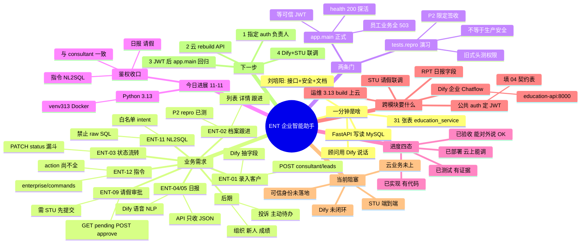
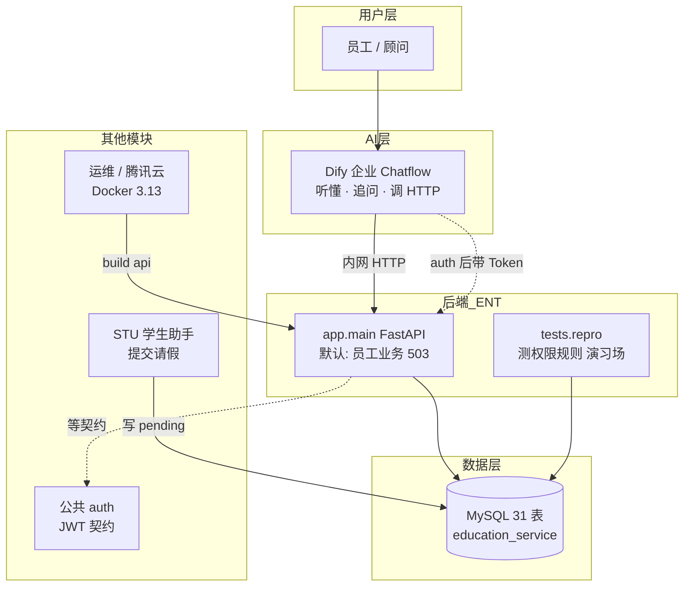
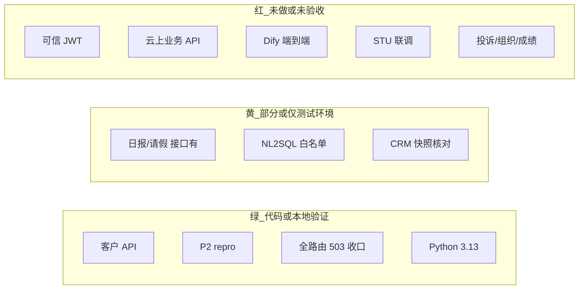

# 企业智能助手（ENT）· 组会讲解思维导图

**用法（XMind）**：直接双击打开  
**`企业智能助手-组会讲解.xmind`**（推荐，结构与下文 mindmap 一致）。  
若打不开：XMind 菜单 **文件 → 导入 → Freemind**，选 **`企业智能助手-组会讲解-Freemind备用.mm`**。  
改图后重新生成：`python scripts/build_ent_xmind.py`。

**用法（Mermaid）**：在 VS Code / Cursor 里预览；或复制到 draw.io。  
**配套**：开口稿 `企业智能助手-组会开口稿-2026-11-11.md`  

---

## 总览（建议讲解顺序：中 → 右「进度」→ 左「分工」→ 下「阻塞」）

---

## 分层图（给新人：谁在哪一层）

---

## 进度红绿灯（会上指图讲）

| 颜色 | 会上怎么说 |
| --- | --- |
| 绿 | 「能展示、能证明的」 |
| 黄 | 「代码有了，不能当产品交付」 |
| 红 | 「明确没做完或等人」 |

---

## 讲解提纲（对照思维导图节点，约 8 分钟）

1. **中心**（30s）：Dify + FastAPI + MySQL，ENT 边界。  
2. **业务需求**（2min）：先讲 01–03 客户 + 09 请假；扩展 NL2SQL；一句带过后期项。  
3. **两条门**（1min）：`app.main` 全 503 vs repro 签收；什么是真实身份回归。  
4. **今日进展**（1min）：3.13 + 四模块鉴权。  
5. **跨模块**（2min）：auth / Dify / STU / 运维 —— 点名要谁。  
6. **阻塞 + 下一步**（1min）：四句话收尾。

---

## 导出提示

- **PPT**：截图 Mermaid 预览或 draw.io 导出 PNG。  
- **飞书文档**：粘贴 `mindmap` 代码块（若不支持则用分层 `flowchart` 图）。  
- **打印**：优先用「分层图」+「进度红绿灯」，一页纸够用。
