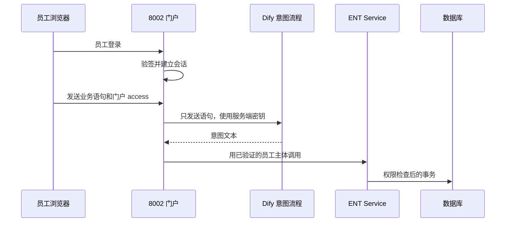
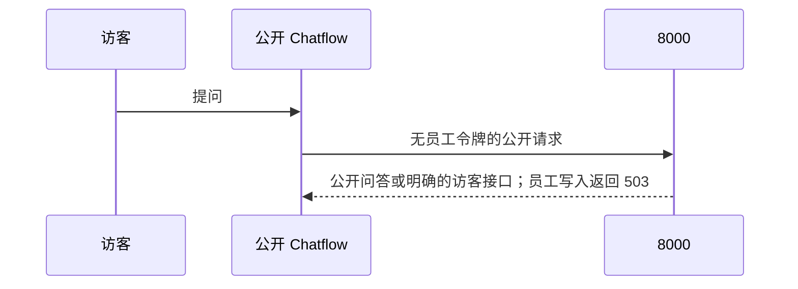

# 64 BASE 统一身份认证架构深化与分阶段开发计划（GPT 复核修订版）

日期：2026-11-12  
原文保留：`64-BASE统一身份认证架构深化与分阶段开发计划-供GPT复核.md`。本文件不覆盖原文。  
本轮只做设计，不改业务代码、数据库、认证逻辑、生产配置和已发布 Dify 工作流，也不执行 `git add`。

BASE 由刘培阳负责技术方案、实现和公共接口。各业务模块确认自己的身份用法和业务授权。不为了让 ENT 先写入数据而降低全组安全标准。8000 在对应验签完成前保持 `blocked`。8002 已有登录、RBAC 和门户 AI 写入保留。

## 本次修订了什么

相对原文，下列设计已改写。原文中关于五张任务卡、复用 `sys_user`、RS256、门户代发和腾讯云演示环境的方向保留。

| 项 | 原文 | 修订 |
| --- | --- | --- |
| 身份 | 员工与管理员写在一起，JWT 又把 `admin` 列成与员工并列的 `user_type` | 全文档只用一套解释，见第 1 节。不改已有数据 |
| `typ` | 用 payload `typ=access` 表示令牌用途，并拟把服务写成 `typ=service` | Header `typ` 只表示 JOSE 类型。用途改用 `token_use`。刷新令牌不是 JWT |
| 旧 HS256 | 过渡期验证器可以同时认识两类令牌 | 旧令牌只在 8002 的门户验签器生效。8000 和其他模块默认不接受 |
| audience | 单体阶段用一个 `education-api` | 单体也按资源受众签发。跨模块要换票，不能一张令牌打全部模块 |
| 刷新 | 只写了轮换和作废 | 补哈希、家族、行锁、并发和重放后的重新登录 |
| 学生 | 默认学生都能用 `sys_user` 登录 | 接口可以设计。账号生命周期未确认前不实现、不启用 |
| Dify | 推荐门户代发 | 拆成已登录工作台和公开 Chatflow 两张时序，边界不同 |
| 会话表 | 继续复用 | 补不改名、不破坏旧行的兼容策略 |
| 组织 | 有成员表草案 | 补唯一主部门、禁止重复有效关系和主管计算；无成员记录不授权 |
| 角色 | 令牌携带 `role` | 角色和权限每次从数据库读取，不放进令牌 |

## 1. 统一身份模型

数据库 `sys_user.user_type` 已有且只解释为三个账号类：`employee`、`admin`、`student`。实施时不修改已有行，也不新增枚举值。

全组只允许下面这一套解释：

| 身份 | 是什么 | 存在哪里 | 运行时主体 | 禁止的解释 |
| --- | --- | --- | --- | --- |
| `employee` | 普通员工账号类 | `sys_user.user_type` | 员工主体。进入现有 `require_employee` | 不是管理员，不是学生，不是服务 |
| `admin` | 数据库里的管理员账号类，属于机构操作账号 | `sys_user.user_type=admin` | 同样进入员工主体通道，因为现有登录已把这类账号当作可登录的机构账号 | 不是独立于员工通道的第五套接口，也不是“把角色改成 admin 的员工行”。不能绕过业务归属检查 |
| `student` | 学生账号类 | `sys_user.user_type=student` | 学生主体。只能进学生依赖 | 不能调用员工审批 |
| `service` | 服务客户端 | 独立客户端表，不是 `sys_user` 行 | 服务主体 | 不能写成 `user_type`，不能带员工号 |
| `guest` | 公开访客 | 没有账号令牌 | 无主体 | 不签发员工或学生 JWT |

`role_code` 是另一列，来自 `sys_role`，表示权限角色。它不改变账号类。因此：

- `user_type=admin` 只说明账号类是管理员账号。权限仍由该行的 `role_id` 及其权限表决定，不自动跳过客户归属或学生范围。
- `user_type=employee` 且 `role_code=admin` 仍然是员工账号类。管理员权限来自角色，账号类保持 `employee`。
- 两种组合都可能出现在现有数据里。模块不得把它们合成一种，也不得只认其中一种。

员工主体通道接受的账号类只有 `employee` 和 `admin`。学生、服务、访客都拒绝。这个句子是 PF、CS、ENT、STU、RPT 的共同口径。

## 2. JWT 字段

JOSE Header 和业务用途分开。

| 位置 | 字段 | 新 BASE 令牌的值 | 来源 | 验证 |
| --- | --- | --- | --- | --- |
| Header | `typ` | 固定 `JWT` | 签发器常量 | 不是 `JWT` 则拒绝。不根据它判断 access 或 service |
| Header | `alg` | 固定 `RS256` | 签发器常量，不从配置热切换成 HS256 | 验签器的算法白名单只有 `RS256`。不读取令牌里的 `alg` 来选择算法 |
| Header | `kid` | 当前私钥编号 | BASE 密钥表 | 未知、停用或与算法不符则拒绝 |
| Payload | `iss` | `edu-base` | 签发器常量 | 必须精确等于这条验签配置 |
| Payload | `aud` | 一个资源受众，见第 4 节 | 登录或换票时指定 | 必须精确等于该路由要求的受众。不接受受众列表里的“全部模块” |
| Payload | `sub` | `sys_user.id` 的十进制字符串；服务令牌则是客户端编号 | 数据库 | 员工和学生令牌的 `sub` 必须对应仍有效的用户。调用方另传的员工号无效 |
| Payload | `sid` | 会话 UUID | `ent_auth_session.id` | 会话必须存在、未撤销、未过期，且属于该 `sub` |
| Payload | `user_type` | 数据库原值：`employee`、`admin` 或 `student` | 签发当时从 `sys_user` 读取 | 每次请求再读数据库。声明值与当前行不一致则拒绝。服务令牌没有这个字段 |
| Payload | `token_use` | `access` 或 `service_access` | 签发器按入口写入 | 员工和学生路由只接受 `access`。服务路由只接受 `service_access`。其他值拒绝 |
| Payload | `iat`、`nbf`、`exp` | 签发、生效、过期 | 签发时钟 | `nbf` 未到或 `exp` 已过则拒绝。access 最长 60 分钟。允许的时钟偏差实施时单独配置，默认不超过 60 秒 |

刷新令牌是 256 位随机不透明字符串，不是 JWT。它没有 Header `typ`，也没有 `token_use`。

角色、权限码、部门、组织列表都不放进令牌。每次验签通过后从数据库读取：账号状态、`user_type`、`role_id`、`role_code`、该角色的权限行、有效组织成员。角色或权限一旦修改，下一次请求就生效，不等待 `exp`。

旧门户令牌保持原样，不改造成这套字段。它的 payload 仍是现有的 `typ=access`、`iss=ent-portal`、`aud=ent-api`、HS256。新验签器不接受这组字段组合。

## 3. 旧 HS256 的隔离

两套验签配置不能共用一个“看令牌算法再分支”的函数。

| 验签器 | 运行位置 | 只接受 | 密钥 |
| --- | --- | --- | --- |
| 门户过渡验签器 | 仅 8002 上现有 ENT 门户路由 | Header 算法按配置固定为 HS256；`iss=ent-portal`；`aud=ent-api`；payload `typ=access` | 现有 `AUTH_JWT_SECRET` |
| BASE 验签器 | 将来的统一入口，以及启用后的 8000 | Header 算法按配置固定为 RS256；`iss=edu-base`；路由指定的资源 `aud`；`token_use=access` 或该路由要求的 `service_access` | 只持有公钥或 JWKS |

约束：

- 8000 不加载门户 HMAC 密钥，也不调用门户过渡验签器。兼容旧 ENT 令牌不能成为 8000 接受 HS256 的理由。
- PF、CS、STU、RPT 默认只配置 BASE 验签器。
- 先根据调用方所在入口选择验签器，再验证。不根据令牌自带的 `alg` 放宽算法。
- HS256 令牌改写 `alg` 为 RS256，或 RS256 令牌改写 `alg` 为 HS256，都由固定白名单拒绝。
- 用公钥当 HMAC 密钥的降级伪造，因两个验签器不共享密钥材料而无效。
- `alg=none` 不在任一白名单中。

负向测试见第 8 节。8002 在过渡期仍能验证自己发出的旧令牌，这不表示其他入口可以验证它。

## 4. audience 与换票

当前虽然是一个 `aiproject` 进程，令牌仍然按资源签发，避免将来拆分时一张令牌能打所有模块。

| 阶段 | audience | 谁可以接收 |
| --- | --- | --- |
| 现在的单体进程 | `edu-api:ent`、`edu-api:pf`、`edu-api:cs`、`edu-api:stu`、`edu-api:rpt` | 只有标注了同一受众的路由 |
| 身份服务自身 | `edu-auth` | 刷新、登出、JWKS 以外的会话管理。JWKS 是公钥，不需要访问令牌 |
| 将来进程拆开 | 同一组资源名 | 各进程只配置自己的受众 |

规则：

- 一张 access 只有一个 `aud`。
- ENT 工作台登录申请 `edu-api:ent`。它不能调用标注为 `edu-api:stu` 或 `edu-api:rpt` 的路由。
- 学生登录即使将来启用，也只申请 `edu-api:stu`。
- 服务令牌的 `aud` 是被允许的那一个资源，不使用通配符。
- 跨模块调用要向 BASE 做 Token Exchange：交出仍有效的源令牌，由 BASE 按已确认的委托政策签发目标受众的新 access，有效期更短，并写审计。没有该政策时不换票。
- 旧门户令牌的 `aud=ent-api` 只被 8002 门户验签器接受，不等于 `edu-api:ent`。不自动映射。

这些字符串是设计名。写入生产配置前仍由相关模块确认。

## 5. Refresh Token

登录成功时创建会话，并签发一个刷新串。数据库表建议为 `auth_refresh_token`，不改现有会话表的名字。

| 列 | 规则 |
| --- | --- |
| `id` | 新行主键 |
| `family_id` | 登录时生成。轮换出的新行沿用同一家族 |
| `session_id` | 对应 `ent_auth_session.id` |
| `user_id` | 令牌所属用户 |
| `token_hash` | 只存 SHA-256。不存明文 |
| `expires_at` | 长于 access。具体天数确认前用不超过 14 天的设计上限 |
| `used_at` | 成功轮换时写入 |
| `revoked_at` | 登出、停用、重放或家族撤销时写入 |
| `replaced_by` | 指向下一张刷新行 |

轮换在一个数据库事务里完成，对命中的那一行 `SELECT … FOR UPDATE`：

1. 哈希找不到：返回 401，不签发。
2. `used_at` 或 `revoked_at` 已有值：把该 `family_id` 下全部刷新行和对应会话标为撤销，提交，返回 401，要求重新登录。
3. 行仍可用：写入 `used_at` 和 `replaced_by`，插入同一家族的新哈希，更新会话到期时间，提交，返回新的 access 和新的刷新串。

两个请求同时拿同一刷新串：后进入锁的请求会看到 `used_at` 已写入，按重放处理，整个家族撤销。先成功的那张新刷新串也会随之失效。客户端必须串行刷新；双击或并发重试会导致重新登录。这是为了让窃取后的重放无法留下可用家族。

登出、改密、重置密码、停用账号撤销该用户相关会话及其刷新家族。密钥停用时撤销用该 `kid` 签发的全部会话。撤销后只能重新登录。

## 6. 学生账号：只设计，不假定已可登录

可以保留 `POST /api/v1/auth/student/login` 的接口形状：只查询 `user_type=student`，成功时签发 `token_use=access`、`aud=edu-api:stu`。员工审批路由拒绝这种令牌。员工令牌也不能调用学生提交路由。

在 STU 确认下列事项之前，不实现、不开放这个接口，也不把现有学生行当作已经可以登录：

- 学生账号由谁创建。
- 初始密码如何设置和送达。
- 密码如何找回。
- 离校、休学和停用由谁写入 `status=disabled`。
- 是否有独立于员工门户的登录入口。
- 现有学生是否都已经在 `sys_user`，以及没有账号的学生如何补齐。

未确认时，学生业务仍按今天的方式：员工侧处理走员工主体；公开或学生侧写入不假借员工令牌。

## 7. 两种 Dify 场景

### 已登录企业工作台

门户保存并验证员工令牌。Dify 不接收该令牌，也不接收可被模型改写的员工号。写库仍进入原来的 service。固定的 Dify API Key 只证明“这是门户在调用 Dify”，不证明员工是谁。

### 公开且未登录的 Chatflow

没有可信员工身份时，只允许公开问答和事先列明的访客业务。不能把 Dify API Key、对话变量、提示词或客户端头当成员工。8000 对员工写入保持 503。

若将来公开 Chatflow 要做员工写入，必须先有已认证的员工入口或安全代理，由该入口持有验签后的员工主体，再调用 service。在那之前不发布这类工作流，也不修改生产认证配置。

## 8. 安全测试

以下测试在隔离库中定义。本轮不运行会改写真实业务数据的用例。

| 编号 | 场景 | 期望 |
| --- | --- | --- |
| N1 | 把 RS256 令牌的 `alg` 改成 HS256，并用公钥当 HMAC 密钥重签 | 两个验签器都拒绝 |
| N2 | 把 HS256 门户令牌送给 8000 | 8000 拒绝，不进入业务 service |
| N3 | 把 `ent-portal` 令牌送给 PF、CS、STU、RPT 路由 | 拒绝 |
| N4 | `edu-api:ent` 的 access 调用 `edu-api:stu` 或 `edu-api:rpt` | 拒绝，且不换票 |
| N5 | `token_use=service_access` 调用员工路由 | 拒绝 |
| N6 | 服务令牌携带 `employee_id` 或 `user_type` | 签发器不产生这种令牌；若手工构造则拒绝 |
| N7 | `alg=none` | 拒绝 |
| N8 | 未知或已停用 `kid` | 拒绝 |
| N9 | 令牌 `user_type=student` 调用员工审批 | 拒绝 |
| N10 | 令牌 `user_type=admin` 访问他人客户 | 仍走归属检查，不因账号类放行 |
| N11 | 数据库中的角色权限已删除，令牌尚未过期 | 下一次请求按新权限拒绝 |
| N12 | 令牌中的 `user_type` 与数据库当前值不一致 | 拒绝 |
| N13 | 会话库不可用 | 503，不降级为只验签名 |
| N14 | 同一刷新串并发两次 | 一个事务提交；另一个发现已使用并撤销整个家族；之后必须重新登录 |
| N15 | 使用已经轮换过的刷新串 | 撤销家族和会话，401，要求重新登录 |
| N16 | 停用账号、改密、登出后再用原 access 和刷新串 | 都拒绝 |
| N17 | 无 `sys_org_member` 记录的员工 | 不获得任何组织范围授权 |
| N18 | 伪造 `X-Employee-Id`、对话变量中的员工号、固定 Dify Key | 不形成员工主体；8000 业务写入仍不发生 |
| N19 | 访客调用 ENT 写入 | 503 或该路由的拒绝，不产生业务行 |

算法白名单、受众和 `token_use` 各用独立断言，避免一个通过掩盖另一个放行。

## 9. 会话表、组织表和权限读取

`ent_auth_session` 继续作为公共会话的物理表，现在不改名，也不回填或删除旧行。现有列 `id`、`user_id`、`expires_at`、`revoked_at`、`create_time` 保持不变。以后新增列必须可空或带默认值，使当前插入语句仍能成功。`issuer` 为空的旧行只表示门户过渡会话，只由 8002 的旧验签器使用。新 BASE 会话写入 `issuer=edu-base`。应用代码按签发入口查询，不把全表都当成门户会话，也不把全表都当成 BASE 会话。

`sys_org_member` 建议列：`user_id`、`org_id`、`is_primary`、`effective_from`、`effective_to`、`status`。

- 同一员工可以有多行，从而加入多个组织。
- 同一 `(user_id, org_id)` 只有一行；重复有效关系由唯一约束拒绝。状态变化在原行更新，历史进审计。
- 主部门用数据库约束保证最多一个：为“有效且 `is_primary`”生成非空键，其余为空；该键唯一。空值可以有多个，所以非主部门不受影响。
- 主管范围：`sys_organization.manager_id` 等于该员工的组织，加上 `parent_id` 可达的下级组织。下属是这些组织里的有效成员，不含主管自己。
- 字符串 `department` 不参加计算。没有成员行的人没有任何组织范围，也不能因为缺少记录而被当成“可看全部”。
- 组织范围只提供给业务模块查询。是否能看某个客户或报告，仍由该模块决定。

## 10. BASE-01～05 验收口径不变

统一身份不改变这五张卡的通过条件。

| 卡 | 验收口径 | 修订版补充 |
| --- | --- | --- |
| BASE-01 | 工程可启动，`/health` 与 `/docs` 可用 | 不把 JWKS 或登录算进这张卡 |
| BASE-02 | 仓库、分支、提交和敏感文件不入库 | 未完成只读清单前禁止 `git add` 整棵目录 |
| BASE-03 | 31 张表、连接、一次 CRUD | 没有 Alembic 不判定本卡失败 |
| BASE-04 | Dify 应用命名、API Key 存放和轮换规则 | 不改已发布工作流 |
| BASE-05 | 腾讯云上的 `aiproject` 能按文档启动 | 必须有云端启动记录。本地 Compose 成功不算完成 |

## 11. 开发顺序

可以并行的只有互不放开 8000 的准备工作。任何阶段都不得为了写入数据把 8000 改成接受旧 HS256 或关闭默认拒绝。

| 顺序 | 工作 | 并行 | 完成前不做什么 |
| --- | --- | --- | --- |
| 1 | BASE-02：只读文件清单、忽略规则、远程认证 | 可与 2 并行 | 不提交 `.env` 和整棵未审目录 |
| 2 | BASE-05：腾讯云 `aiproject` 启动记录 | 可与 1 并行 | 不用本机 8000 代替云端验收 |
| 3 | BASE RS256 签发、公钥和 JWKS；验签器算法固定 | 与 4 同一实现，不能拆成先兼容后收紧 | 8000 仍保持 blocked，直到这条验签器接入并测完 N1～N8 |
| 4 | 旧 ENT JWT 只留在 8002 | 属于 3 的隔离测试 | 不把 `ent-api` 映射成 `edu-api:ent` |
| 5 | 刷新家族、撤销、密钥轮换 | 依赖 3 | 不在没有 N14、N15 时启用刷新 |
| 6a | 服务身份 | 可在 5 之后独立做 | 服务令牌不能带员工号 |
| 6b | 学生登录实现 | 不可提前 | 等第 12 节的 STU 事项确认后才编码和开放 |
| 7 | `sys_org_member` 与约束 | 可在 5 之后与 6a 并行 | 无成员数据时不授予组织权限 |
| 8 | 五个模块按资源受众逐个接入 | 一个模块测完再下一个 | 不一次把所有路由放进同一个受众 |
| 9 | Dify：工作台继续门户代发；公开流保持访客边界 | 依赖 3 和 4 的负向测试 | 不发布新的写库工作流 |

学生接口的设计以第 6 节为准，可以留在文档里。编码位置放在 6b，不插到 RS256 之前。

## 12. 仍需其他模块确认的事项

这些确认不改变 BASE 的安全底线。未确认的项目保持关闭，不用临时令牌代替。

| 模块 | 要确认的内容 |
| --- | --- |
| 全组 | 资源受众名称、`edu-base`、RS256 和换票政策可以写入配置的时间 |
| PF | 哪些员工可以上传和查看研判结果 |
| CS | 哪些接口对访客开放；后台管理使用哪一个员工受众 |
| STU | 第 6 节的账号创建、初始密码、找回、停用、登录入口，以及学生是否都已在 `sys_user` |
| RPT | 主管范围计算之后，哪些报告行可见 |
| ENT | 8002 过渡期结束时，门户如何改为领取 `edu-api:ent` 的 RS256，同时保留现有页面和 RBAC |
| Dify | 公开流的访客接口白名单。员工写入继续只走工作台，直到另有已认证入口 |

本轮没有修改业务代码、认证逻辑、数据库、生产配置、已发布工作流，也没有把目录加入 Git。原文 64 号仍然保留。等待下一轮审核；通过前不开始 P1 之后的实现。
