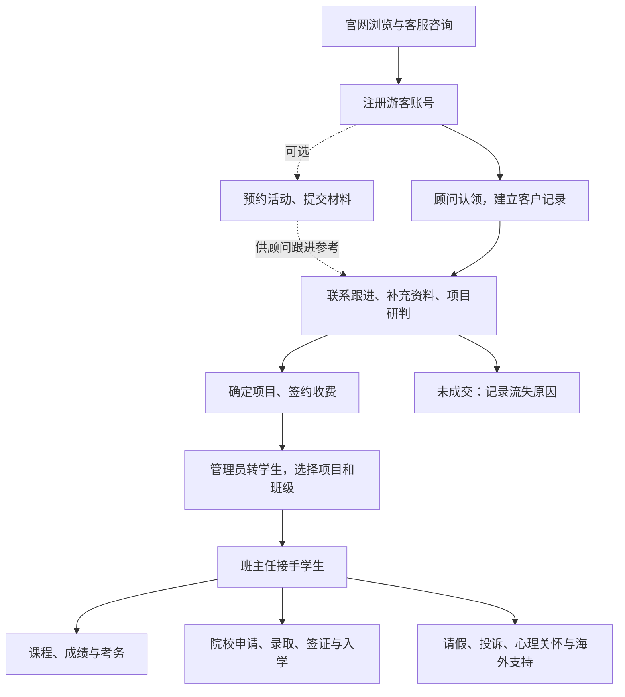

# 粤教教育服务系统完整业务流程

记录日期：2026年11月17日

整个系统围绕一条主线展开：先由顾问把咨询用户跟进成客户，签约后由管理员转为学生并安排班级，再由班主任负责教学、申请和日常学生服务。

本文记录已确认的业务规则、各环节职责及当前实现情况。合同收款、学生成绩查询、阶段推进和服务结束等尚未完成衔接的部分，单独列明。

## 业务主流程

图中表示业务顺序。签约收款等尚未形成完整系统闭环的环节，见后文说明。

## 1 业务开始前的基础配置

管理员需要配置项目、班级、老师、教学课程、员工账号和岗位权限，并维护官网内容与活动。

已经明确的业务关系如下：

- 一个项目可以有多个班级。
- 一个班级只有一名班主任，一名老师可以负责多个班级。
- 一名学生当前归属一个班级。
- 管理员把教学课程安排到班级，班主任据此录入成绩。
- 教学课程区分预科、语言培训、海外院校三个阶段，课程不另收费。

几种业务对象的含义如下：

| 业务对象 | 含义 |
| --- | --- |
| 项目 | 客户签约的服务项目，项目费用在签约环节收取 |
| 班级 | 用于组织学生、确定班主任和安排课程 |
| 教学课程 | 用于教学和成绩管理，不单独收费 |
| 教学阶段 | 标明课程、成绩和考务属于预科、语言培训还是海外院校阶段 |

## 2 官网咨询与注册游客

未登录用户可以浏览项目介绍、了解服务，并向官网客服咨询。

注册登录后，用户可以预约活动、提交材料、维护个人信息。这时系统保存的是官网账号，尚未开通学生服务。

活动和材料是帮助顾问了解客户的渠道。用户可以先咨询、先预约活动，也可以先提交已有资料，不必严格按照固定顺序操作。

## 3 顾问认领与客户跟进

顾问在游客跟进中认领用户，系统建立该顾问名下的客户记录。

之后由顾问持续完成联系、需求了解、资料补录、项目研判和下一步跟进。电话联系记录会同步到客户跟进历史，避免同一件事重复记录。

客户状态主要沿着以下方向推进：

**新客户 → 联系中 → 已确认意向 → 已签约**

未继续成交的客户，可以登记流失及原因。官网游客被认领后，当前会直接建立“联系中”的客户记录；其他来源的客户也可以由顾问录入。

## 4 资料核对与项目研判

顾问逐步确认客户的年龄、学历、在读或毕业情况、意向项目和专业方向。

资料不足时由顾问继续补充。资料齐全后，系统进行初筛，AI 辅助生成建议、沟通话术和下一步问题。顾问根据这些结果与客户沟通、确认项目。

管理员负责独立登记已核实的姓名和本人手机号。文件导入时，系统核对资料归属，展示预览，再由操作人确认写入。

研判用于辅助选择项目，正式申请条件和录取结果仍需要后续办理确认。

## 5 项目确认与签约收费

已确认的收费规则是：**项目费用在签约环节收取，教学课程不单独收费。**

业务上，这一步应当明确客户购买的项目、服务内容，以及签约和收款情况，然后交接给学生服务环节。

当前系统已经支持登记“已签约”，但还有一个明确缺口：**合同、收款记录和到账确认尚未形成完整闭环，转学生也尚未强制校验“已签约、已收款”。**

因此，目前“顾问标记已签约”和“管理员开通学生身份”仍是两个独立操作。收款确认由哪个岗位负责，也需要明确。

## 6 管理员转学生与入班交接

管理员找到对应官网账号，新建或关联学生档案，然后选择项目及该项目下的班级。

保存后，系统确定学生的班级、班主任和留学地区，并开通官网学生服务。学生继续使用原来的官网账号，之前的材料、预约等记录保留。

这时形成两条持续关系：

- 顾问保留原客户的跟进关系。
- 班主任负责学生的学务办理。

院校申请进度由班主任维护，原顾问可以按授权查看。

历史学生也由管理员安排入班，支持逐人或批量操作。

## 7 入班后的并行业务

学生入班后，课程学习、院校申请和日常事务可以并行开展。

| 业务 | 谁负责 | 具体过程 |
| --- | --- | --- |
| 教学课程与成绩 | 管理员安排课程，班主任录入成绩 | 按教学阶段、课程和学期记录成绩，更正保留历史 |
| 考务 | 班主任发布，学生查看和办理 | 可按学生或整班发布考试、论文及其他截止事项 |
| 院校申请 | 班主任维护，顾问查看 | 材料准备 → 提交 → 审核 → 录取 → 签证 → 入学 |
| 请假 | 学生申请，班主任审批 | 可附证明，审批后学生查看结果、收到通知 |
| 学习投诉 | 班主任处理 | 接单、跟进、记录解决说明，反馈给学生 |
| 公司投诉 | 主管处理 | 管理员、主管可纠正分类并重新分派 |
| 心理关怀 | 授权班主任跟进 | 内部预警、学生主动关怀申请、自评及后续跟进 |

每项事务都应走完以下过程：

**提交或发布 → 分派负责人 → 办理 → 记录结果 → 通知相关人**

请假和投诉会同步生成待办，办理完成后更新对应待办。内部心理预警及老师跟进记录只在授权员工范围内查看。

## 8 教学阶段与海外服务衔接

系统管理预科、语言培训和海外院校三个教学阶段，具体参与哪些阶段，应按学生的项目安排确定。

例如，学生可以一边接受语言培训，一边准备院校申请；获得录取后继续办理签证和入学，进入海外院校后仍可记录课程成绩、考务及关怀事项。

学生端根据留学地区提供相应政策和海外生活资料。

目前三个教学阶段主要用于课程、成绩和考务的分类，尚未形成统一的“阶段完成后自动推进下一阶段”的学籍流程。

## 9 转班与班主任工作交接

管理员负责转班或更换班主任。调整时，学生归属和以下未完成事项一起交给新老师：

- 待审批请假。
- 未完成学习投诉。
- 未结心理预警。
- 未结关怀个案。

相关待办同步换人，公司投诉继续由主管负责。历史成绩、审批及跟进记录保留原操作人。

老师停用或调离岗位前，必须先完成交接；新班主任接手后，原老师的普通学生访问范围随之调整。

## 10 员工协作与管理监督

顾问、班主任等员工提交本人的日报和周报，主管按组织授权查看工作情况、业务统计和投诉情况。

班主任另外可以查看负责学生范围内的心理统计、生成并审核心理周报。这与老师自己的工作周报分别管理。

AI分别辅助官网咨询、顾问研判、学生服务、员工办理和报告整理。员工AI的查询与操作使用员工当前权限，涉及业务写入时先展示内容、核对确认，再执行。

## 当前仍需补足的业务衔接

| 环节 | 当前情况 |
| --- | --- |
| 合同、收款与转学生 | 尚未关联成强制校验流程，收款确认岗位也需要明确 |
| 学生成绩查看 | 员工端已能录入和查询，学生端尚无独立成绩查询入口 |
| 考务与成绩关联 | 发布考务和录入成绩分别操作，尚未按同一场考试关联 |
| 教学阶段推进 | 已有阶段分类，阶段完成、升段条件尚未形成正式流程 |
| 服务结束 | 结业、退学、退费及档案保留的正式流程仍需确定 |
